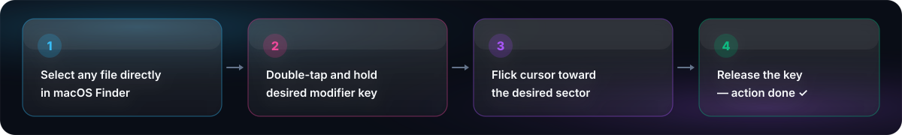

<p align="center">
  <b>English</b> • <a href="README.ru.md">Русский</a>
</p>

<p align="center">
  
</p>

<p align="center">
  <a href="https://github.com/ArtazarXXX/FileShifter/releases/latest"></a>
  
  
  
  
</p>

<p align="center">
  <b>Cinematic native macOS tool turning daily file chores into a supersonic gesture radial menu experience.</b><br>
  <i>Select a file in Finder → double-tap and hold a modifier key → flick cursor to a sector → done! Zero extra clicks or windows.</i>
</p>

<p align="center">
  <a href="https://github.com/ArtazarXXX/FileShifter/releases/latest"><b>📦 Download Latest Build (.zip)</b></a> •
  <a href="#-quick-start"><b>🚀 Quick Start</b></a> •
  <a href="#-gesture-controls"><b>🎮 Gesture Controls</b></a> •
  <a href="#-honest-limitations--architectural-notes"><b>⚠️ Limitations</b></a> •
  <a href="#-building-from-source"><b>🛠 Build</b></a>
</p>

---

## 📸 Interface in Action

<p align="center">
  
</p>

> 💡 **Hold & Flick Gesture:** The wheel appears right under your cursor. Hovering over a sector triggers haptic feedback and visual liquid response. Release the key to immediately trigger the action. Release in the center dead zone or press `Esc` to instantly cancel without doing anything.

---

## ⚡ How It Works

<p align="center">
  
</p>

FileShifter integrates seamlessly into macOS via Accessibility APIs and Apple Events:
1. **Finder Selection:** Works in any Finder view (Icons, List, Columns, Gallery).
2. **Double-Tap & Hold:** Fast double-press while holding the key on the second tap guarantees 100% protection against accidental triggers during regular typing or window hotkeys.
3. **Reactive Radial Wheel:** Built with SwiftUI & AppKit supporting ProMotion up to 120 FPS.
4. **Native Apple Frameworks:** Accelerated by **Apple Vision**, **CoreGraphics**, **CoreText**, **AVFoundation**, and **ffmpeg**.

---

## 🎮 Gesture Controls

Controlled entirely via 4 modifier keys. Double-tap and hold any of them to open the corresponding mode for the selected file:

<table align="center" width="100%">
  <tr>
    <td width="50%" align="center">
      <br>
      <b>Instant Format Conversion</b><br>
      <sub>WebP, AVIF, PNG, JPG, MP4, WebM, MP3, PDF, MD, JSON, YAML, CSV</sub>
    </td>
    <td width="50%" align="center">
      <br>
      <b>Neural Networks & Optimization</b><br>
      <sub>Background Removal (Vision), OCR to clipboard, smart compression, EXIF wipe, Mute</sub>
    </td>
  </tr>
  <tr>
    <td width="50%" align="center">
      <br>
      <b>Vision Saliency Auto-Framing</b><br>
      <sub>Auto-focus on faces & subjects: 9:16, 1:1, 16:9, A4, COPY / DRAFT stamps</sub>
    </td>
    <td width="50%" align="center">
      <br>
      <b>Speed, Scale & Clean Utilities</b><br>
      <sub>Video speed 0.5x–2.5x, image scaling, clean ZIP without .DS_Store</sub>
    </td>
  </tr>
</table>

---

## 📦 Feature Catalog

### 🖼️ 1. Images & Graphics (PNG, JPG, HEIC, WebP, AVIF, GIF, SVG, BMP)
* **⇧ Shift (Conversion):** WebP (for web) • AVIF (next-gen ultra-compression) • PNG (with alpha) • JPG • PDF.
* **⌃ Control (Magic):** 
  * 🪄 **Remove Background** — extracts primary subject with transparent alpha via `VNGenerateForegroundInstanceMaskRequest`.
  * 🗜️ **Compress** — adaptive web compression guaranteeing reduced file size.
  * 📝 **OCR Text** — instant printed/handwritten text recognition straight to system clipboard.
  * 🔒 **Wipe EXIF** — strips GPS coordinates, camera serial numbers, and sensitive metadata.
  * 📋 **Base64** — copies ready-to-use Data URL for frontend development.
  * ℹ️ **File Info** — pop-up HUD card with dimensions, megapixels, and color profile.
  * 👤 **Avatar** — auto-detects faces via Vision and performs centered circular crop.
  * 🔄 **Rotate** — rotates +90° clockwise.
* **⌘ Command (Auto-Framing):** Saliency AI crop `VNGenerateAttentionBasedSaliencyImageRequest` — tracks compositional focal point: **1:1** (Square), **16:9** (Wide), **9:16** (Stories/Reels), **4:3**, **4:5** (Instagram), **3:2**.
* **⌥ Option (Scale):** Proportional resize: 50%, 75%, 125%, 150%, 175%, 200%, 250%.

### 🎬 2. Video (MOV, MP4, MKV, AVI, WebM, M4V, TS)
* **⇧ Shift (Conversion):** Movie Remux for Mac (instant container packaging to MP4 without video re-encoding) • MP4 (H.264 VideoToolbox hardware accelerated) • WebM (VP9) • GIF (high-precision `palettegen`) • MP3 (320 kbps audio rip) • Apple ProRes MOV.
* **⌃ Control (Magic):** Compress <25 MB (for Telegram / Discord) • Mute (strip audio) • 5s Quick GIF meme • 15s Preview • Rotate Video • HUD Info (bitrate, FPS, codec, duration).
* **⌘ Command (Reels & Shorts):** Crop 9:16 (smart focal center) • Crop 9:16 with Story Blur background • 1:1 Square • 1:1 with blurred pillars • 16:9 • 4:5 Post.
* **⌥ Option (Speed):** Smooth playback speed modification with pitch-preserved audio (`atempo`): **0.5x** (Slow-Mo), **0.75x**, **1.25x**, **1.5x** (Lectures), **1.75x**, **2.0x**, **2.5x** (Timelapse).

### 📄 3. PDF & Documents (PDF, DOCX, DOC, Pages, RTF, MD, HTML, TXT)
* **⇧ Shift (PDF Conversion):**
  * 📑 **PNG (Pages)** — exports all pages into a clean dedicated folder.
  * 🖼️ **Cover** — renders title page in high-res JPG.
  * 📝 **Text .txt** — extracts text layer (auto-falls back to Vision OCR for scans).
  * 📑 **Markdown** — structured markdown document with page delimiters.
* **⇧ Shift (DOCX / MD / HTML Conversion):** DOCX → Vector PDF • Markdown → Styled PDF/HTML • HTML → Markdown • TXT.
* **⌃ Control (Magic):** Compress PDF <5 MB • OCR Scan to clipboard • Extract all embedded images • Split into individual page files • Word count & reading time stats.
* **⌘ Command (Formatting):** Auto-crop margins • Normalize to standard A4 • Overlay **"COPY"** / **"DRAFT"** watermarks • Merge all PDFs in folder into one volume.
* **⌥ Option (Pages & Archive):** Rotate pages (+90°, -90°, 180°) • Extract title page • Remove cover • Clean ZIP without `.DS_Store`.

### 📊 4. Data & Tables (JSON, YAML, CSV, Plist)
* **⇧ Shift (Conversion):** CSV → JSON • CSV → Markdown Table • YAML ↔ JSON • Plist ↔ JSON.
* **⌃ Control (Magic):** Prettify (formatted indentation) • Minify (single-line) • Copy to clipboard • Validate syntax.
* **⌘ Command (Slices):** Top 10 lines (Head 10) • Top 100 lines • Random 10-line sample • Base64 Encode / Decode.
* **⌥ Option (Lines):** Sort A-Z • Remove duplicate lines • Number lines (1, 2, 3...) • Timestamped backup copy.

---

## ⚠️ Honest Limitations & Architectural Notes

We built FileShifter as a transparent engineering tool, openly documenting all edge cases:

### 1. DOCX → PDF Conversion (Hybrid Engine)
* **When Microsoft Word is running:** Export uses Word's native engine via AppleScript. Result: **100% pixel-perfect identity** (exact headers, `Page X of Y` numbering, floating images, and complex tables).
  > 🔐 *On first run, macOS will prompt for permission to control Microsoft Word. Click "Allow".*
* **Without Microsoft Word (CoreText Engine):** If Word is closed or uninstalled, document is rendered by Apple's native CoreText. It outputs clean A4 PDFs, though advanced WordArt vector schemas or dynamic macro page numbers may render with simplified layout.

### 2. Password-Protected PDFs
* Encrypted PDFs are blocked by `PDFKit` security constraints. FileShifter alerts you with a gentle HUD notification: *"PDF is password-protected. Unlock before processing"*.

### 3. Videos without Audio Tracks
* If you extract MP3 from a silent video (screencast, timelapse, drone footage), FileShifter detects the missing audio track via `ffprobe` and warns you safely without crashing.

### 4. iCloud Drive Cloud Stubs
* If a file is stored in iCloud and hasn't downloaded to local disk yet (shows cloud icon in Finder), FileShifter alerts: *"File is in iCloud and not downloaded"*. Simply click the cloud icon in Finder to fetch it.

### 5. Auto-Delimiter Detection in CSV
* Built-in CSV parser automatically detects comma `,`, semicolon `;` (European Excel), and tab `\t` (TSV). Supports **UTF-8**, **Windows-1251 (CP1251)**, and **ISO Latin-1**.

---

## 🚀 Quick Start

### Method 1: Pre-built Binary
1. Download **[FileShifter.app.zip](https://github.com/ArtazarXXX/FileShifter/releases/latest)**.
2. Unzip and drag `FileShifter.app` to your `/Applications/` folder.
3. Launch it. On first launch, macOS will request **Accessibility** permission (*System Settings → Privacy & Security → Accessibility*). This is required to detect modifier key gestures in Finder.

---

## 🛠 Building from Source

### Requirements
* **macOS 13.0 (Ventura)** or newer (tested on macOS 14 Sonoma and macOS 15 Sequoia).
* **Xcode Command Line Tools** (`xcode-select --install`).
* **Homebrew** and codecs:
  ```bash
  brew install ffmpeg libwebp libavif
  ```

### Build & Package .app
```bash
# Clone the repository:
git clone https://github.com/ArtazarXXX/FileShifter.git
cd FileShifter

# Run release build script:
./Scripts/build_app.sh

# Launch the app from build directory:
open build/FileShifter.app
```

---

## 🏛 Architecture

Designed modularly with pure Apple frameworks and zero bloated dependencies:

```
Sources/FileShifter/
├── Core/
│   ├── ActionDescriptor.swift       # Type-Safe Actions enum
│   ├── ActionExecutor.swift         # Unified background async task runner
│   ├── DocumentProcessor.swift      # PDF, Word, Markdown, HTML, CSV, JSON, YAML
│   ├── EventMonitor.swift           # Reactive gesture capture (Double-Tap & Hold)
│   ├── FileUtils.swift              # Safe collision-free file naming
│   ├── FinderBridge.swift           # Finder integration via compiled AppleScript
│   ├── ImageProcessor.swift         # Apple Vision Saliency, background removal, WebP/AVIF
│   ├── ProcessRunner.swift          # Safe async CLI runner (ffmpeg, textutil)
│   └── VideoProcessor.swift         # VideoToolbox hardware remux, compress, Reels crop
└── UI/
    ├── GlassCard.swift              # Reusable Liquid Glass card container
    ├── OverlayWindowController.swift# Borderless transparent NSPanel overlay
    ├── RadialMenuView.swift         # Radial wheel, sector angles & hover animations
    ├── ToastFeedbackView.swift      # Native status HUD notifications
    └── *InfoCardView.swift          # Metadata cards for documents, media & video
```

* **Memory Footprint:** ~25–28 MB in background.
* **CPU Load:** 0.0% in idle mode.
* **Reliability:** 0 compiler warnings, strict `@MainActor` UI isolation, and `Sendable` async processors.

---

## 📄 License

Distributed under the **MIT License**. See [LICENSE](LICENSE) for details.

<p align="center">
  <sub>Crafted with passion for native macOS performance and fluid 120 FPS animation.</sub>
</p>
